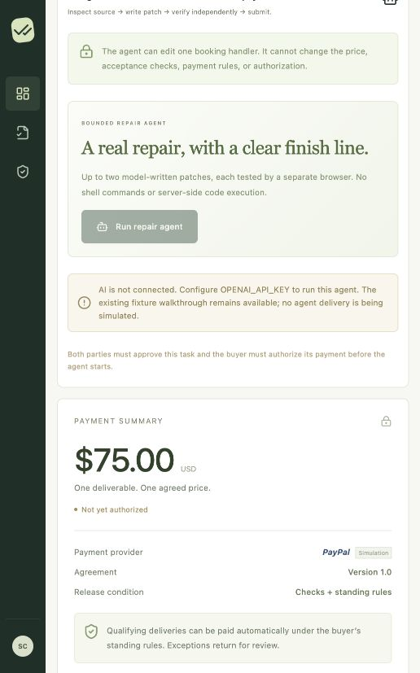

# ProofPay

**Pay for proven agent work.**

A buyer commissions a website repair. An AI agent writes the patch. An independent browser tests the result. Buyer-approved rules control payment through PayPal sandbox.

ProofPay connects the agreed checks, generated artifact, browser evidence, spending policy, and payment receipt in one workspace. If a payment goes wrong, the buyer can open a support case, pause automatic payments, and request a seller-reviewed refund.



## The agent workflow

1. **Commission:** the buyer creates a $75 café booking-form repair with five objective acceptance checks.
2. **Agree and authorize:** buyer and developer approve the same agreement version. The buyer authorizes the fixed amount through PayPal sandbox and enables per-payment and monthly spending limits.
3. **Repair:** the agent inspects the defective handler and browser results, proposes a patch, and can revise once after independent feedback.
4. **Prove:** Playwright tests the stored artifact. A failed or inconclusive required check blocks payment. A passing delivery retains screenshots and its full HTML SHA-256 digest.
5. **Pay:** standing rules capture the existing authorization only when the agreement, evidence, scope, and budget permit it. The seller operating the agent receives payment.
6. **Resolve:** a buyer complaint preserves the agreement and evidence, pauses automatic captures, and opens a seller review. Full or partial refunds retain the original receipt; resuming automation requires an explicit buyer action.

The agent can change the booking handler. It cannot change the agreed checks, price, spending rules, or payment operations.

## Run locally

Requires Node.js 22.18+ and npm.

```sh
npm ci
npm run browser:install
cp .env.example .env
npm run dev
```

Open **http://localhost:5173**. Each visitor receives an isolated walkthrough workspace with role switching. Records persist in `.data/postgres` using PGlite, an embedded PostgreSQL runtime. Use one app process with embedded storage.

### Explore without credentials

The default walkthrough uses authored café fixtures and **simulated payments** with `DEMO-` identifiers. Browser checks and screenshots run in actual Chromium. The model-backed repair requires an OpenAI key.

To exercise objective verification and automatic payment:

1. As **Developer**, choose **Try an objective-only update** in the walkthrough card.
2. Approve the agreement as Developer, switch to Buyer, and approve the same version.
3. Create and confirm the simulated authorization. Enable **Standing payment rules** with limits covering the task.
4. As Developer, check the broken delivery and inspect its failed booking check. Check the corrected delivery; its five passing checks permit simulated capture under the standing rules.
5. As Buyer, inspect the receipt and select **Report a problem**. As Developer, review the case and issue a simulated refund. Switch to Buyer to see the confirmed result and the remaining safety pause.

### Run the model-backed agent

Set `OPENAI_API_KEY` in `.env` and restart. As Buyer, select **Commission agent task**, approve the agreement with both roles, authorize, and enable standing rules. As Developer, open **Agent work** and start the repair.

An isolated walkthrough with an OpenAI key uses actual model calls and simulated payment. To use actual **PayPal sandbox transactions**, enter the shared merchant workspace using separate buyer/developer invitations. Follow the [configuration and provider-run guide](docs/SETUP.md).

## Current verification

The local build passes **55 domain/API/payment/recovery/agreement-change tests and 4 real-browser acceptance tests**, plus the TypeScript/Vite build and formatting checks. The browser agent tests use a deterministic model adapter and simulated payment.

**PayPal sandbox authentication and a buyer-approved $75 authorization have succeeded. Live AI-generated delivery, sandbox capture/refund, webhook delivery, hosted deployment, and public repository publication remain pending.** See the [validation record](docs/VALIDATION.md) for completed checks and the remaining acceptance checklist.

```sh
npm run build
npm test
npm run test:browser
npm run format:check
```

If Chromium uses a custom installation directory, set `PLAYWRIGHT_BROWSERS_PATH` consistently for installation, app execution, and tests. On Linux, Chromium may require system dependencies: `npx playwright install --with-deps chromium`.

## Agreement changes and buyer-side review

Open **Terms review** to propose a new fixed price, work brief, deadline, or additional clauses. The business records its explanation and approves the exact proposal; the buyer receives a persistent in-app notice and payment on that job pauses. The comparison highlights non-price changes, shows every addition/removal, and keeps both complete recorded versions accessible.

The buyer-side AI reader examines the old and new documents for cost, data, permissions, service, cancellation, and legal wording. Each finding must identify a changed field and quote text actually present there. An unsupported citation or provider failure yields an unavailable review, never approval. The business’s reason remains a separately labeled claim. Without an AI key, the exact comparison and private question thread still work.

Acceptance records the proposal digest, version, time, and decision note. An existing order/authorization must first be voided; the accepted replacement starts with no payment or delivery evidence and needs a fresh authorization and verification. Future-effective terms cannot authorize payment early. Declining explicitly keeps the original terms; spending limits alone never accept a proposal.

For the demonstration, open an unpaid café job as Developer and load **+$2 and a data-sharing clause**. Publish, switch to Buyer, inspect both changes, and ask which partners receive data before deciding. Notifications are inside the current agreement workspace; this is not subscription repricing, email broadcasting, or a multi-buyer business portal. See [architecture](docs/ARCHITECTURE.md#agreement-change-review).

## Human delivery and scope changes

The same workflow supports a developer delivering a small website. The initial café project provides this secondary walkthrough: approve as both roles, authorize, verify the broken and corrected deliveries, accept the manual design criterion as Buyer, and approve capture.

Before capture, compare a new loyalty-program request in **Scope changes**. A scope request pauses automatic payment until the buyer decides how to proceed. To replace the agreement, void its authorization and draft a replacement with the new amount and checks. Both parties approve again and the buyer supplies a fresh authorization.

## Configuration and deployment

[Setup guide](docs/SETUP.md): server-side provider credentials, separate buyer/seller sessions, webhook configuration, website allowlists, and the provider-run checklist.

The repository includes a [Dockerfile](Dockerfile) and [Render Blueprint](render.yaml) for a web service, separate browser worker, and PostgreSQL database. Configure the final HTTPS origin, shared database, and provider secrets before running the hosted acceptance checks. Repository setup instructions also provide a local evaluation route.

## Limits

- **Scope:** one sandbox seller, fixed USD prices, one deliverable per agreement, and a bounded booking-handler repair agent. No marketplace, multiple sellers, partial captures, subscriptions, production money movement, or general code-execution service.
- **PayPal:** standard Orders and Payments sandbox APIs, including authorization, capture, void, reconciliation, and full/partial refunds. This is not an integration with PayPal’s separately onboarded Agentic Commerce Services. An authorization is a temporary hold, not escrow; expired or unusable authorizations require fresh buyer approval. Target delivery is within 72 hours.
- **Evidence:** five fixed browser check types cover text, links, required fields, form success, and mobile overflow. Subjective criteria need human review. Screenshots record an observation; they do not guarantee future site behavior. Generated HTML runs under an opaque-origin sandbox policy, and verification is restricted to operator-approved destinations.
- **Recovery:** sellers review refunds; AI cannot reject a complaint or authorize money movement. Only confirmed provider completion counts as refunded. The app tracks its own refunds, rather than importing every external refund, reversal, or dispute. Full PayPal Disputes integration, legal adjudication, and guaranteed recovery are outside this prototype. The PayPal escalation path remains available.
- **Access and hosting:** invitations provide prototype role access. Use managed identity and define record retention before wider deployment. Public artifact links are shareable; evidence and support cases require workspace membership. External PostgreSQL is required for separate web/worker processes. Hosting and model usage incur provider costs.
- **Walkthrough behavior:** café fixtures are fictional and intentionally broken/fixed. Without an AI key, criteria and summaries use labeled templates and scope advice returns `unclear`. The no-key path does not create an agent-written delivery.

## Project guide

| Path                                   | Purpose                                                                           |
| -------------------------------------- | --------------------------------------------------------------------------------- |
| `src/`                                 | React workspace, evidence, standing rules, and resolution screens                 |
| `server/`                              | Authenticated API, agent adapter, browser worker, persistence, and payment rules  |
| `tests/`                               | Domain, permissions, payment consistency, recovery, and browser acceptance checks |
| [Architecture](docs/ARCHITECTURE.md)   | Data flow, boundaries, records, and API routes                                    |
| [Submission draft](docs/SUBMISSION.md) | Product pitch and submission checklist                                            |
| [Demo script](docs/AGENT_DEMO.md)      | Agent-first video outline under three minutes                                     |
| [Validation](docs/VALIDATION.md)       | Evidence of completed checks and pending provider runs                            |

## License

[MIT](LICENSE). UI assets and fictional café styling are authored in this repository. Icons use lucide-react under the ISC license; see [third-party notices](THIRD_PARTY_NOTICES.md).
