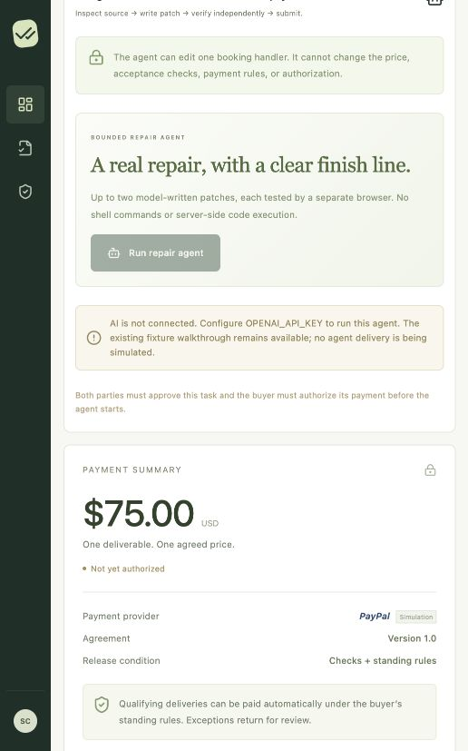
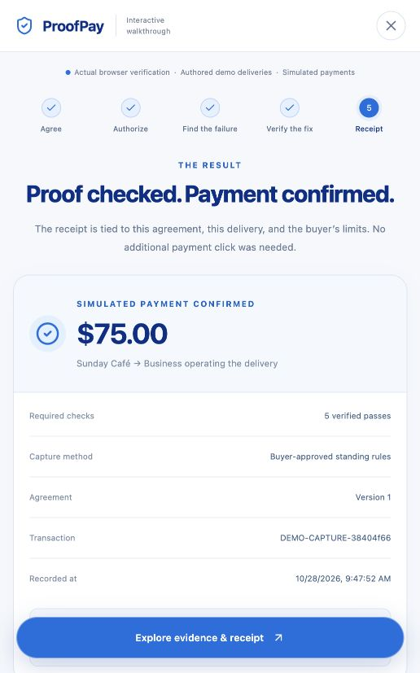

# ProofPay

**Pay for proven agent work.**

A buyer commissions a website repair. An AI agent writes the patch. An independent browser tests the result. Rules the buyer approved control payment through the PayPal sandbox.



## How it works

1. **Commission:** the buyer creates a $75 café booking-form repair with five objective acceptance checks.
2. **Agree and authorize:** buyer and developer approve the same agreement version. The buyer authorizes the amount through PayPal and sets per-payment and monthly limits.
3. **Repair:** the agent reads the broken handler and the browser results, asks a model for a patch, and can revise once after independent feedback.
4. **Prove:** Playwright tests the stored artifact in real Chromium. A failed or inconclusive required check blocks payment. A passing delivery keeps its screenshots and the SHA-256 digest of its HTML.
5. **Pay:** standing rules capture the existing authorization only when the agreement, evidence, scope and budget allow it.
6. **Resolve:** if the buyer reports a problem, automatic payments pause, the evidence is kept, and the seller can issue a full or partial refund against the original capture.

The agent can change the booking handler. It cannot change the agreed checks, the price, the spending rules, or any payment operation. The café repair is small on purpose; the same pattern fits any agent task whose result a machine can check.

Afterwards the buyer can ask **why did this payment happen?** Decision replay shows the inputs saved at capture time, lets a policy lab rerun the same evaluator on copies, and exports a proof bundle with a checksum. See [features in depth](docs/FEATURES.md) for replay, agreement-change review and human-delivery projects.

## Try it

Requires Node.js 22.18+ and npm.

```sh
npm ci
npm run browser:install
cp .env.example .env
npm run dev
```

Open **http://127.0.0.1:5173** and click **Start interactive demo**. No keys are needed: you play both roles through five chapters (agree, authorize, find the failure, verify the fix, receipt) using real Chromium checks and simulated payments.



To have a model write the repair, set `OPENAI_API_KEY` in `.env` and restart. Chapter four then offers **Let the AI agent write the fix**: the agent asks the model for a patch, Chromium tests each patch against the same five checks, and the receipt lists every patch with its code and digest. For real PayPal sandbox transactions, use the merchant workspace with separate buyer and developer invitations. Run `npm run preflight` to see which route your machine is ready for; it makes one small request to each configured provider, prints no secrets and moves no money. Details are in the [setup guide](docs/SETUP.md).

| Route                                             | Agent repair                  | Browser checks | Payment                        |
| ------------------------------------------------- | ----------------------------- | -------------- | ------------------------------ |
| Guided demo, no keys                              | Authored broken/fixed fixture | Real Chromium  | Simulated, `DEMO-` identifiers |
| Guided demo or agent task with an OpenAI key      | Written by the model          | Real Chromium  | Simulated, `DEMO-` identifiers |
| Merchant workspace with OpenAI and PayPal sandbox | Written by the model          | Real Chromium  | PayPal sandbox Orders/Payments |

The interface labels each route the same way.

## Verification

```sh
npm run build
npm test
npm run test:browser
npm run format:check
```

The build passes **80 unit/API tests and 7 real-browser tests** plus the TypeScript and Vite checks. The agent browser tests use a deterministic or mocked model and simulated payment.

**PayPal sandbox authentication and a buyer-approved $75 authorization have succeeded. Live AI-generated delivery, sandbox capture/refund, webhook delivery and hosted deployment remain pending.** The [source repository](https://github.com/harsharajkumar-273/Paypal-AI-hackathon-) is public under the MIT license. See the [validation record](docs/VALIDATION.md) for completed checks and the remaining acceptance checklist.

See the [validation record](docs/VALIDATION.md) for what has been run and what has not. If Chromium lives in a custom directory, set `PLAYWRIGHT_BROWSERS_PATH` for installation, the app and the tests. On Linux, Chromium may need system packages: `npx playwright install --with-deps chromium`.

## Limits

- **Scope:** one sandbox seller, fixed USD prices, one deliverable per agreement, and a bounded booking-handler repair agent. No marketplace, multiple sellers, partial captures, subscriptions, production money movement, or general code-execution service.
- **PayPal:** standard Orders and Payments sandbox APIs, including authorization, capture, void, reconciliation, and full/partial refunds. This is not an integration with PayPal’s separately onboarded Agentic Commerce Services. An authorization is a temporary hold, not escrow; expired or unusable authorizations require fresh buyer approval. Target delivery is within 72 hours.
- **Evidence:** five fixed browser check types cover text, links, required fields, form success, and mobile overflow. Subjective criteria need human review. Screenshots record an observation; they do not guarantee future site behavior. Generated HTML runs under an opaque-origin sandbox policy, and verification is restricted to operator-approved destinations.
- **Recovery:** sellers review refunds; AI cannot reject a complaint or authorize money movement. Only confirmed provider completion counts as refunded. The app tracks its own refunds, rather than importing every external refund, reversal, or dispute. Full PayPal Disputes integration, legal adjudication, and guaranteed recovery are outside this prototype. The PayPal escalation path remains available.
- **Access and hosting:** invitations provide prototype role access. Use managed identity and define record retention before wider deployment. Public artifact links are shareable; evidence and support cases require workspace membership. External PostgreSQL is required for separate web/worker processes. Hosting and model usage incur provider costs.
- **Walkthrough behavior:** café fixtures are fictional and intentionally broken/fixed. Without an AI key, criteria and summaries use labeled templates and scope advice returns `unclear`. The no-key path does not create an agent-written delivery.

## Deployment

The [Dockerfile](Dockerfile) and [Render Blueprint](render.yaml) define a web service, a separate browser worker and a PostgreSQL database. Configuration, webhooks and the provider-run checklist are in the [setup guide](docs/SETUP.md). `npm run smoke -- <origin>` checks a running deployment without credentials.

## Project guide

| Path                                 | Purpose                                                                     |
| ------------------------------------ | --------------------------------------------------------------------------- |
| `src/`                               | React workspace, evidence, standing rules and resolution screens            |
| `server/`                            | Authenticated API, repair agent, browser worker, persistence, payment rules |
| `tests/`                             | Domain, permissions, payment, recovery and browser acceptance tests         |
| [Architecture](docs/ARCHITECTURE.md) | Data flow, boundaries, records and API routes                               |
| [Features](docs/FEATURES.md)         | Decision replay, agreement changes, human delivery                          |
| [Setup](docs/SETUP.md)               | Configuration, provider runs and hosting                                    |
| [Validation](docs/VALIDATION.md)     | Completed checks and pending provider runs                                  |
| [Submission](docs/SUBMISSION.md)     | Hackathon text and checklist                                                |
| [Video guide](docs/AGENT_DEMO.md)    | Timed script and recording steps                                            |

## License

[MIT](LICENSE). UI assets and fictional café styling are authored in this repository. Icons use lucide-react under the ISC license; see [third-party notices](THIRD_PARTY_NOTICES.md).
