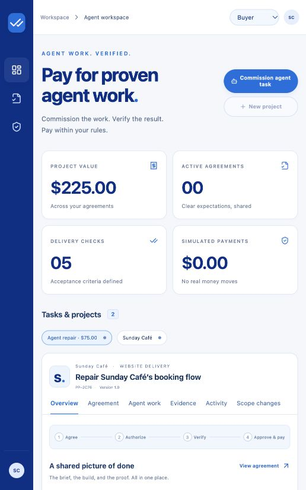

# ProofPay

**Agree on the work. Prove it works. Then pay.**

ProofPay is a prototype payment layer for verified agent work. A buyer commissions a bounded website-repair task, a model-backed agent writes the repair, an independent browser checks the artifact, and buyer-approved standing rules govern PayPal sandbox capture. The same agreement and evidence workflow also supports human freelance delivery.



## Run locally

Requires Node.js 22.18+ and npm. No credentials or database server are needed for the isolated walkthrough.

```sh
npm ci
npm run browser:install
cp .env.example .env
npm run dev
```

Open **http://localhost:5173**. Each visitor gets a private walkthrough workspace. Local records persist in `.data/postgres`, using PGlite (embedded PostgreSQL). Run one app process when using embedded storage. Use an external PostgreSQL database when running a separate worker.

If Chromium is installed at a custom location, set `PLAYWRIGHT_BROWSERS_PATH` for both installation and the app/test commands.

### The five-minute walkthrough

1. Open **Agreement** and approve as **Developer**.
2. Switch to **Buyer** in the right column. Approve the same agreement version.
3. Start and confirm the **simulated authorization** in Payment summary.
4. Switch to **Developer**, open **Evidence**, and check the first delivery. Its booking form fails; four automated checks pass. Open a screenshot.
5. Check the corrected delivery. All five automated checks pass.
6. Switch to **Buyer**, review the café preview, and accept the visual criterion in Evidence.
7. Approve and simulate payment. Inspect the receipt and Activity history.

To test scope handling, do so **before capture**: enter a loyalty-program request in Scope changes, compare it, switch to Buyer and void authorization, then switch to Developer and draft a replacement. Review its checks. Both parties must approve and authorize the replacement again.

**Disclosure:** café pages are fictional, deliberately broken/fixed fixtures. Walkthrough payments are simulations with `DEMO-` identifiers. Browser execution and screenshots are real. Without an AI key, café checks and result summaries are explicitly labeled templates; scope analysis returns `unclear`, not a fabricated AI result. No real PayPal transaction or AI call is claimed by the default walkthrough.

## Enable AI and real PayPal sandbox payments

Set values in `.env`; never commit it. Restart the app after changing credentials.

- `OPENAI_API_KEY`: enables structured criteria proposals, advisory scope comparison, and evidence summaries using the OpenAI Responses API. `OPENAI_MODEL` is configurable; default `gpt-4.1-mini`.
- `PAYPAL_CLIENT_ID`, `PAYPAL_CLIENT_SECRET`: credentials from a **sandbox** REST app. The API base is hard-coded to `api-m.sandbox.paypal.com`; production payment credentials are unsupported.
- `PAYPAL_WEBHOOK_ID`: register the HTTPS endpoint `/api/paypal/webhook` in the same sandbox app. Subscribe to authorization and capture events. All webhooks are verified with PayPal before any processing.
- `DEVELOPER_INVITE`, `BUYER_INVITE`: distinct random secrets, each at least 32 characters. Generate each with `openssl rand -hex 32`. Share each privately with its intended role. Paste an invitation into **Connections & access** to enter the shared merchant workspace. Demo role switching is disabled there.
- `APP_URL`: the frontend origin, e.g. `http://localhost:5173` locally or the final hosted HTTPS origin. This controls PayPal redirects and mutation origin checks.
- `ALLOWED_ORIGINS`: comma-separated, operator-controlled **HTTPS origins**, e.g. `https://your-test-cafe.example`. Visitors cannot expand this list. Private and reserved IP destinations are denied.
- `ALLOWED_FORM_ENDPOINTS`: exact URLs allowed to receive automated test submissions. The form check currently fills `input[name="name"]` and `input[name="email"]`, clicks its submit control, and requires both an HTTP-success POST response from the approved action URL and visible agreed success text. Use dedicated test endpoints with no real reservations or notifications.

The real merchant workspace starts empty. Create an agreement using the approved HTTPS delivery URL, price, brief, deadline within 72 hours, and reviewed checks. Each check is explicitly editable. Buyer and developer sign in separately using their invitations. Buyer creates the PayPal order, opens **Continue on PayPal**, approves using a sandbox buyer account, returns, and presses **I approved · confirm authorization**. No browser pop-up approval is treated as payment confirmation.

Use a separate sandbox personal account as buyer and a sandbox business account as seller. Only the configured seller receives funds. This prototype is not a multi-seller marketplace or an escrow provider. Authorization is a temporary hold, not a guarantee of payment or dispute protection. The intended delivery window is 72 hours; authorization expiration requires fresh buyer approval.

### Two public test fixtures

The app serves `/fixtures/broken` and `/fixtures/fixed`. Real merchant work must use the **same approved URL** before and after a fix. For an honest real sandbox demonstration, host the café fixture on an approved HTTPS test origin and update its booking handler at that URL between submissions. The built-in `fixture:` shortcut is restricted to isolated walkthroughs.

## Checks and builds

```sh
npm run build
npm test
npm run test:browser
```

The browser test launches actual Chromium, submits the approved test form, distinguishes broken/fixed deliveries, and asserts screenshot evidence. Other tests cover workspace isolation, permissions, version resets, scope replacement, expired authorizations, latest-run eligibility, unsafe network addresses, and repeated simulated capture. Real PayPal and AI integration require configured accounts and must be tested before submission; mocked or simulated tests do not establish successful live sandbox integration.

For a production-style local run:

```sh
npm run build
APP_URL=http://localhost:3001 npm start
```

## Deploy on Render

A Dockerfile and `render.yaml` Blueprint define a web service, separate browser worker, and PostgreSQL database. These are paid resources; review current Render pricing before deployment.

1. Create a public GitHub repository and push this source, including `LICENSE` and `package-lock.json`.
2. In Render, create a Blueprint using the repository. Configure prompted secrets and website allowlists.
3. Set the web service `APP_URL` to its final HTTPS origin. Set the worker `FIXTURE_ORIGIN` to that same **public** origin, so built-in walkthrough fixtures are reachable from the separate worker. Do not set it to a private Render hostname.
4. Configure the same `ALLOWED_ORIGINS`, `ALLOWED_FORM_ENDPOINTS`, and AI configuration for web and worker. Both use the same database.
5. Configure PayPal webhooks and run a complete sandbox transaction on the deployed build. Confirm `/api/health` succeeds, the worker consumes jobs, and screenshot evidence loads only for its owning workspace.

`RUN_WORKER=false` on the web service avoids duplicate local worker loops. In development it defaults to true. Deploying multiple replicas requires external PostgreSQL; PGlite is for a single local process only.

## Project guide

- `server/`: domain rules, authenticated API, persistence, PayPal adapter, structured AI, and browser worker.
- `src/`: responsive React workspace and all product interactions.
- `tests/`: payment/permission invariants and real browser verification.
- [Architecture and API](docs/ARCHITECTURE.md)
- [Submission description and video script](docs/SUBMISSION.md)
- [Validation record and remaining launch checks](docs/VALIDATION.md)

## Limits

This is a hackathon prototype. It intentionally supports a single seller, fixed USD price, one deliverable per agreement, and five explicit browser check types. It does not implement refunds, arbitration, partial payments, reauthorization, agent hiring, production payments, or a legal guarantee. A check's screenshot is a captured observation, not cryptographic proof that the delivered site remains unchanged. Invitations are a prototype access mechanism; use managed identity before wider deployment. Webhook records and demo workspaces need an operator-defined retention policy for longer-running hosting.

MIT licensed. UI assets and fictional café styling are authored in this repository. Icons are from lucide-react (ISC license).

## Agent work: a payment layer for proven output

The buyer can now **Commission agent task** from the workspace header. The first supported task is deliberately bounded: repair the fictional café’s booking submit handler while preserving five objective requirements.

1. Switch to Buyer in your isolated walkthrough and commission a $75 repair task.
2. Both Buyer and Developer approve its criteria. Buyer authorizes payment and explicitly enables **Standing payment rules** (for example, $150 per capture and $500 per UTC calendar month).
3. Open **Agent work** and run the repair agent. This requires `OPENAI_API_KEY`; without it the control is disabled and no AI run is fabricated.
4. The agent inspects the defective source, measures the baseline with a browser, requests an actual model-written handler patch, stores the artifact, and runs independent browser checks. It can revise once using observed failures.
5. A passing artifact is submitted with its full HTML SHA-256 digest. Standing rules capture only an existing authorization within the buyer’s limits. Failed or inconclusive work cannot trigger payment.

The agent cannot edit the agreement, tests, amount, policy, or payment adapter. Generated code is never executed by Node or a shell. Published artifact HTML is stored immutably and served under a sandboxed, opaque-origin browser policy; verification blocks unapproved network destinations and only permits the synthetic reservation endpoint. Artifact URLs contain no account data or credentials. They are public, unguessable demo-delivery links; evidence remains workspace-authenticated.

**Standing rules:** only buyers can enable, change, or pause them. All captures in the current UTC month count toward the budget, including manual captures; unresolved captures reserve their full amount across month boundaries. Budget reservation is atomic across concurrent deliveries. New scope pauses automation until the buyer explicitly keeps the original scope or commissions a replacement. A paused policy cannot undo an already-dispatched payment. Rules permit capture of an existing authorization, not unattended new charges or subscriptions.

For a no-key walkthrough of automatic capture, Developers can create **Try an objective-only update** in the walkthrough card, then use the original broken/corrected authored fixtures. That remains a fixture demonstration and is not described as an agent delivery.

The browser test in `tests/agent.browser.ts` uses a **deterministic model adapter**, real browser execution, and simulated payment. It deliberately proposes a false success message first, verifies that it fails, then supplies a working patch. This establishes orchestration and verifier behavior; it does **not** establish a successful live OpenAI call. A real model + real PayPal sandbox recording is still required before submission.

Payment goes to the single configured sandbox seller operating the agent. This is not a marketplace, multi-agent payout system, or integration with PayPal’s separately onboarded Agentic Commerce Services. It uses standard Orders and Payments sandbox APIs.

## Payment problems, support cases, and refunds

Every authorized or captured payment exposes **Report a problem** to its buyer. The report captures an immutable snapshot of the agreement version, policy, payment identifiers, and observed delivery results. New automatic captures in the single buyer/seller workspace pause immediately; a request cannot recall a capture already dispatched.

Open **Resolution** to follow the case and add information. In the walkthrough, switch roles to try both sides:

1. **Buyer:** report an unrecognized payment, incorrect amount, duplicate charge, delivery concern, or another issue. A request is not a confirmed refund.
2. **Seller/Developer:** review the saved evidence, record a response, and issue a full or partial refund against the original capture. A declined request requires an explanation; no AI verdict dismisses a complaint automatically.
3. **Buyer:** follow refund status, accept a confirmed partial settlement if appropriate, or ask for another review after a declined/resolved case. PayPal’s separate Resolution Center remains linked.
4. **Buyer:** explicitly clear the safety pause after cases are closed and no refunds are pending. Closing or refunding a case does not automatically resume standing rules.

Before capture, the buyer can cancel and void an authorization instead of refunding money that was not charged. The affected agreement cannot be captured while its case is open. After capture, refunds use the server-side sandbox Payments API and the original capture ID. The original receipt stays intact, with refund records alongside it.

Refund amounts are reserved atomically. Repeated requests use a stable request ID and cannot silently create another refund; an uncertain response keeps its reservation. Retry uses the same amount, note, and idempotency key. A known provider refund ID can be reconciled, and verified refund webhooks update tracked refunds. Only `COMPLETED` confirmation counts as refunded. A confirmed state is not downgraded by a delayed pending response. Refunds do not replenish the monthly auto-pay budget.

**Limits:** demo refunds are explicitly simulated; actual sandbox refunds still require configured credentials. The app tracks refunds initiated through its own controls. It does not implement PayPal’s complete Disputes API, adjudicate legal eligibility, guarantee recovery, or automatically import all refunds/reversals made externally. If the provider reports an external balance change or an unsupported dispute state, the seller must reconcile through PayPal; a failed/uncertain attempt is never shown as money returned. Support notes are private to the workspace; no external emails are sent by this feature.
